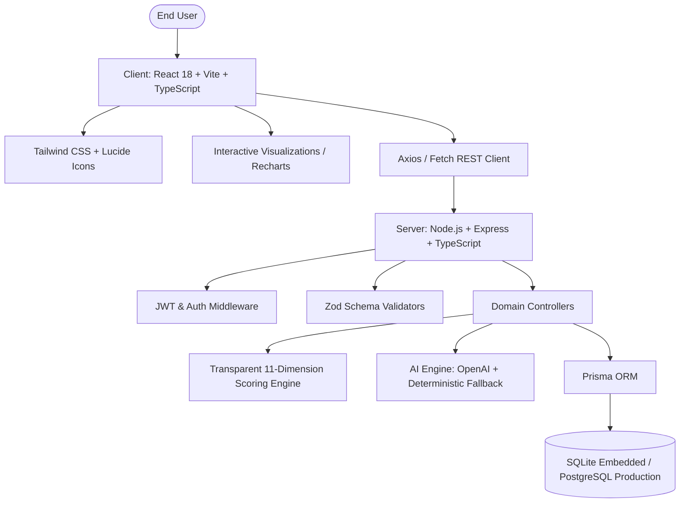

# Human Digital Twin Architecture

## 1. System Vision & Overview
The **Human Digital Twin** is an AI-powered multidimensional digital replica and analytics platform that continuously models, quantifies, and evaluates a human being's state across 11 core holistic dimensions:
1. Physical Health
2. Fitness & Lifestyle
3. Nutrition
4. Mental Health
5. Emotional Wellness
6. Personality Profile
7. Social Relationships
8. Education & Career
9. Financial Health
10. Sleep Tracking
11. Daily Habit System

The architecture is structured as a decoupled, high-performance, strictly typed full-stack system designed for local zero-config execution as well as production containerized scalability.



## 2. Decoupled Architecture

### Frontend Layer (`client/`)
- **Core:** React 18 with TypeScript and Vite for sub-second HMR and optimized bundler output.
- **Styling:** Tailwind CSS with a curated slate & electric blue/cyan digital-twin palette, dark mode first, glassmorphism cards, micro-interactions, responsive grids.
- **Routing:** React Router v6 with public (Login, Register) and protected routes (Dashboard, Modules, Analytics, AI Reports, Profile).
- **Data Visualization:** Recharts (Radar, Area, Line, Bar, and Gauge indicators).
- **State & Form Management:** React Hook Form + Zod schema validation for strict type-safe form inputs and zero runtime errors.

### Backend Layer (`server/`)
- **Runtime:** Node.js v24 with TypeScript, run via `tsx` in development and compiled to `dist/` with `tsc` for production.
- **API Framework:** Express.js 4.x with RESTful architectural conventions.
- **Security:**
  - `bcryptjs` salted password hashing (10 salt rounds).
  - Signed JSON Web Tokens (`jsonwebtoken`) with expiration.
  - Strict user-isolation enforcement in middleware (`req.user.id`). One user cannot view, mutate, or query another user's data.
  - Centralized error-handling middleware intercepting Zod validation errors, Prisma errors, and HTTP status codes.
- **Scoring Engine (`scoring.service.ts`):** Transparent mathematical scoring algorithms for every single dimension (0–100 scale), complete with explicit calculation formulas, missing data handling, and overall composite Digital Twin score computation.
- **AI Intelligence Service (`ai.service.ts`):** Dual-mode AI system:
  1. OpenAI GPT-4o-mini API integration when `OPENAI_API_KEY` is configured in environment.
  2. Local deterministic heuristic AI engine that executes deep algorithmic pattern analysis across sleep, fitness, mood, financial savings, and habits to produce structured summaries, observations, and recommendations without requiring external network connectivity or paid API tokens.

### Data Layer (`prisma/schema.prisma`)
- Fully normalized relational schema with 17 entities.
- Non-destructive historical preservation: all health vitals, fitness logs, emotions, moods, habits, and sleep records retain timestamped histories rather than simply overwriting data.
- Dual compatibility: Configured out-of-the-box with SQLite (`file:./dev.db`) for immediate standalone execution without installing external database servers, and 100% compatible with PostgreSQL in production by switching `datasource db { provider = "postgresql" }`.

---

## 3. Directory Layout
```
Human-Digital-Twin/
├── client/
│   ├── public/
│   ├── src/
│   │   ├── assets/
│   │   ├── components/       # Reusable UI cards, badges, modal, navbar, score-gauge
│   │   ├── context/          # AuthContext, ThemeContext
│   │   ├── hooks/            # useAuth, useDashboard, useTwinData
│   │   ├── layouts/          # DashboardLayout, AuthLayout
│   │   ├── modules/          # 11 dimension modules (form & metrics)
│   │   │   ├── personal/
│   │   │   ├── health/
│   │   │   ├── fitness/
│   │   │   ├── nutrition/
│   │   │   ├── mental/
│   │   │   ├── emotional/
│   │   │   ├── personality/
│   │   │   ├── social/
│   │   │   ├── education/
│   │   │   ├── financial/
│   │   │   ├── sleep/
│   │   │   └── habits/
│   │   ├── pages/            # DashboardPage, AnalyticsPage, AIReportsPage, SettingsPage
│   │   ├── services/         # api.ts (REST client with JWT token injection)
│   │   ├── types/            # TypeScript interfaces
│   │   ├── utils/            # formatting, calculations, colors
│   │   ├── App.tsx
│   │   └── main.tsx
│   └── package.json
│
├── server/
│   ├── src/
│   │   ├── config/           # environment, prisma client, constants
│   │   ├── controllers/      # auth, profile, health, fitness, mental, etc.
│   │   ├── middleware/       # auth.middleware, error.middleware, validate.middleware
│   │   ├── routes/           # REST route index and modular routes
│   │   ├── services/         # scoring.service, ai.service, twin.service
│   │   ├── validators/       # Zod schemas for all request payloads
│   │   ├── utils/            # jwt, password, response formatters
│   │   └── app.ts            # Express server initialization & lifecycle
│   ├── prisma/
│   │   └── schema.prisma     # 17 normalized models
│   └── package.json
│
├── docs/                     # Full system documentation
├── legacy_backup/            # Safe backup of the original prototype
├── .env.example
├── .gitignore
├── DEVELOPMENT_PROGRESS.md
├── README.md
└── package.json              # Monorepo task runner
```
